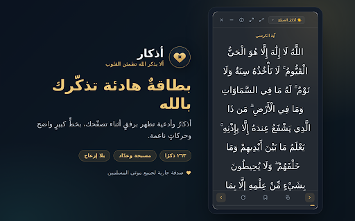
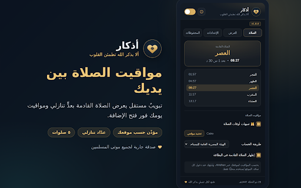
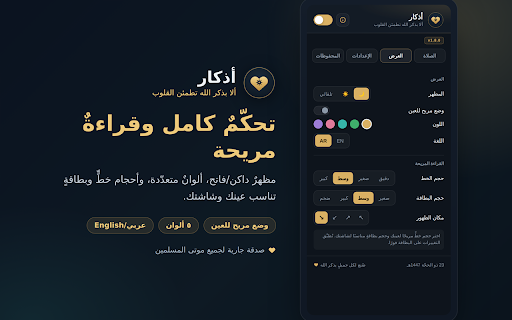

  

<h1 align="center" dir="rtl" lang="ar">أذكار</h1>

<strong>رفيق المسلم أثناء التصفح</strong>

  <a href="https://chromewebstore.google.com/detail/libagpbppfgncllgoakcnfcoalfohijm"><strong>ثبّت الإضافة من سوق Chrome</strong></a>
  · <a href="store-assets/PRIVACY-POLICY.md">سياسة الخصوصية</a>
  · <a href="#english">English</a>

  

<section dir="rtl" lang="ar">
  <h2>أذكارك أثناء التصفح</h2>
  <ul>
    <li><strong>أذكار وأدعية</strong> — ٢٦٣ ذكرًا ودعاءً في ٨ فئات، مع تذكيرات الصباح والمساء والصيام وقراءة سورة الكهف يوم الجمعة.</li>
    <li><strong>بطاقة عائمة ومسبحة</strong> — اقرأ بخط واضح، واستخدم عدّاد التسبيح، واحفظ أذكارك المفضّلة أو انسخها.</li>
    <li><strong>مواقيت الصلاة</strong> — فعّلها اختياريًا لعرض المواقيت حسب موقعك، مع عدّ تنازلي للصلاة القادمة وتنبيهات.</li>
    <li><strong>عرض يناسبك</strong> — اختر ألوان الواجهة وحجم النص والبطاقة ومكانها، وتحكّم في التنبيهات.</li>
  </ul>
</section>

  
المزيد من صور الإضافة · More screenshots

  

    
     
    
     
    
  

  <h2>الخصوصية والدعم</h2>
  
توضّح <a href="store-assets/PRIVACY-POLICY.md">سياسة الخصوصية</a> بالعربية والإنجليزية طريقة حفظ الإعدادات، ومتى تُستخدم خدمة AlAdhan لمواقيت الصلاة الاختيارية، وكيف تتواصل مع المطوّر.

## English

**Azkar** brings gentle reminders for daily remembrance and duas into Chrome. Read from a floating card, count tasbeeh, and save your favorites. Set your own reminder and display preferences, and enable prayer times based on your location.

This repository is the public home for Azkar’s store images and bilingual privacy policy. Install the extension from the [Chrome Web Store](https://chromewebstore.google.com/detail/libagpbppfgncllgoakcnfcoalfohijm). For privacy and support information, see the [privacy policy](store-assets/PRIVACY-POLICY.md).
